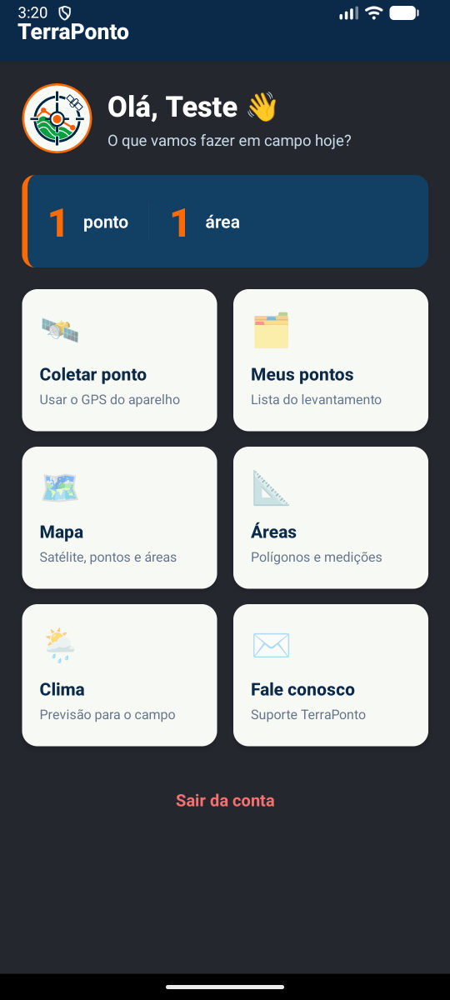
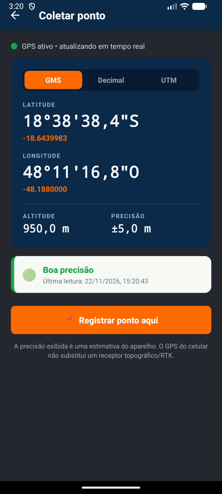
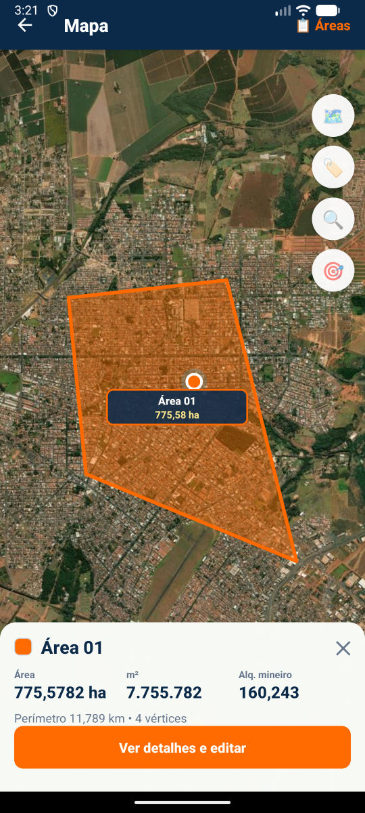
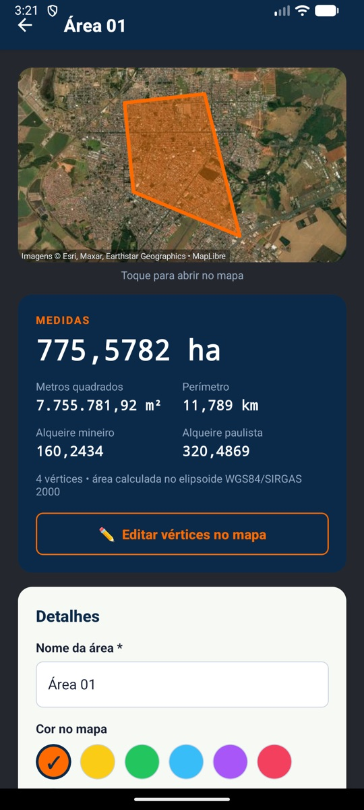

# TerraPonto - Do ponto ao terreno

Aplicativo em React Native (Expo + TypeScript) para levantamento de campo
(topografia / georreferenciamento): coleta de pontos com o **GPS do próprio aparelho**,
fotos, mapa de satélite com desenho e medição de áreas e exportação (CSV, KML, ZIP).
Trabalho da disciplina de Dispositivos Móveis — Prof. Crispim Luiz Martins.

📄 **Documentação**
- [`docs/ENTREGA.md`](docs/ENTREGA.md) — requisitos do trabalho × implementação, capturas de tela e roteiro de avaliação
- [`docs/DOCUMENTACAO_TECNICA.md`](docs/DOCUMENTACAO_TECNICA.md) — stack, arquitetura MVVM, modelo de dados, telas, mapa, fórmulas geodésicas, exportação, build e decisões técnicas

<p>
 
 
</p>

## Requisitos do trabalho atendidos

| Requisito                    | Onde                                                        |
| ---------------------------- | ----------------------------------------------------------- |
| Cadastro / Login / Home      | `pages/cadastro`, `pages/login`, `pages/home`               |
| + 4 telas (feitas 8)         | `novoPonto` (coleta GPS), `meusPontos`, `detalhePonto`, `mapa`, `areas`, `detalhePoligono`, `clima`, `contato` |
| Formulário                   | **Detalhes do ponto**, **Detalhe da área**, **Fale conosco** (e Cadastro/Login) |
| Lista                        | **Meus pontos** e **Áreas** (`FlatList`), previsão do **Clima** |
| API                          | **Clima** (Open-Meteo, GET) e **Fale conosco** (JSONPlaceholder, POST) |
| CRUD completo                | Pontos e áreas: criar, ler, atualizar e excluir             |
| Hooks                        | `useState`, `useEffect`, `useRef`, `useContext`, `useCallback`, `useMemo`, `useLayoutEffect`, `useFocusEffect` + hooks próprios |
| Arquitetura                  | MVVM: View (`pages`, `components`) · ViewModel (hooks, `context`) · Model (`services`) |

## Fluxo de um ponto

1. **Coletar ponto** – o app pede permissão de localização e mostra em tempo real
   latitude/longitude (graus decimais e GMS), altitude e precisão, com semáforo
   verde/laranja/vermelho. Ao tocar em *Registrar ponto aqui*, as coordenadas e a
   **hora da coleta** são gravadas (o usuário não digita coordenadas).
2. **Página do ponto** – abre logo após a coleta. As coordenadas ficam somente
   leitura; o usuário completa nome, tipo (Marco, Divisa, Vértice, Árvore,
   Construção, Outro), responsável e observações, e anexa uma **foto** pela câmera
   ou galeria. Também é possível ver o clima no local e excluir o ponto.
3. **Meus pontos** – lista com miniatura, tipo, coordenadas, hora e precisão;
   toque para abrir/editar, lixeira para excluir.

As fotos são copiadas para a pasta privada do app e apagadas junto com o ponto.

### Formato das coordenadas (GMS / Decimal / UTM)

Uma chave nas telas de coleta, detalhe e lista alterna entre graus-minutos-segundos,
graus decimais e **UTM** (zona, banda, E/N em metros, meridiano central). A escolha
fica salva e vale para todo o app. A conversão UTM (`src/services/geodesia.ts`,
fórmulas de Snyder/USGS sobre o elipsóide WGS84 ≈ SIRGAS 2000) foi validada contra
valores gerados pelo PROJ em 6 pontos de referência, com diferença abaixo de 1 mm.

### Mapa de satélite, pontos e áreas

- **Imagens de satélite** Esri World Imagery, com **cache em disco**: o que já foi visto
  com internet continua disponível sem sinal (o app avisa "Sem internet — exibindo o
  mapa salvo"). Botão 🗺️/🛰️ alterna **satélite ↔ ruas** (OpenStreetMap, a escolha fica
  salva) e 🏷️ liga rótulos de cidades sobre o satélite.
- **Motor do mapa** (`src/components/mapa/`): as telas usam só o componente `MapaBase`.
  No **APK** ele usa o **MapLibre** (aberto, **sem chave de API**, cache de até 300 MB);
  no **Expo Go**, que não traz o MapLibre, usa o `react-native-maps` com a chave do próprio
  Expo. Mesma fonte de imagem do app CortexGeo (Esri, sem chave).
- **Pontos** aparecem com o nome; tocar abre a página do ponto.
- **Desenhar área**: toque no mapa para criar vértices, toque num ponto coletado para
  usá-lo como vértice, "Vértice GPS" usa a posição atual, arraste para ajustar,
  desfazer. Área e perímetro ao vivo e alerta de lados que se cruzam.
- Cada área tem **nome, observações e cor**; a etiqueta (nome + área) fica no centro.
  Tocar na área mostra um cartão; "Ver detalhes" abre a edição, com medidas em ha, m²,
  alqueire mineiro e paulista, edição de vértices e exclusão. Lista em **Áreas** com total.
- Área calculada no elipsóide WGS84 (plano local com raios de curvatura), validada
  contra a fórmula exata da zona elipsoidal: erro < 0,2 ppm até ~11 km de lado.

Obs.: nomes e etiquetas são desenhados numa camada sobre o mapa, posicionada pela
projeção Web Mercator — funciona igual nos dois motores (no `react-native-maps` 1.20
com a nova arquitetura, marcadores com texto saem cortados no Android).

### Exportar (CSV, KML e ZIP com fotos)

Em *Meus pontos* ou em *Áreas*, o botão **⬇️ Exportar** abre um menu com:

- **Completo (ZIP)** – `terraponto_exportacao_AAAAMMDD_HHMM.zip` com `pontos.csv`,
  `areas.csv`, `terraponto.kml`, a pasta `fotos/` (ex.: `P001_divisa-norte-cerca.jpg`)
  e um `LEIA-ME.txt`
- **Google Earth (KML)** – pontos e áreas com nomes, descrições e as cores escolhidas
  (abre no Google Earth, Google My Maps e QGIS)
- **Pontos (CSV)** – `terraponto_pontos_AAAAMMDD_HHMM.csv`

`areas.csv`: `codigo; nome; area_m2; area_ha; alqueire_mineiro; perimetro_m; vertices;
cor; observacoes; criado_em; atualizado_em; wkt` — a coluna `wkt` traz o polígono em
Well-Known Text, que o QGIS carrega direto como geometria.

Depois de gerar, o usuário escolhe **Compartilhar** (WhatsApp, e-mail, Drive...) ou
**Salvar no aparelho** (seletor de pastas do Android).

Colunas do CSV: `codigo; nome; tipo; latitude; longitude; altitude_m; precisao_m;
utm_zona; utm_leste_m; utm_norte_m; coletado_em; atualizado_em; responsavel;
observacoes; foto; recoletas`. Separador `;` (padrão do Excel em português),
codificação UTF-8 com BOM, datas em ISO 8601 no horário local (ex.: `-03:00`).

### Recoleta (editar a localização)

Na página do ponto, *Recoletar localização* abre o GPS ao vivo mostrando o
**deslocamento** e o **azimute** em relação à coordenada atual. Ao confirmar, a
localização e a hora são substituídas e a coleta anterior vai para o **histórico**
do ponto (nome, tipo, observações e foto são mantidos).

## Estrutura

```
App.tsx                     # Providers + rotas
scripts/gerar-icones.js     # Gera logo recortada e ícones a partir da arte original
src/
├── routes/index.tsx        # React Navigation (rotas públicas x privadas)
├── context/AuthContext.tsx # Usuário logado (sessão persistida)
├── services/
│   ├── storage.ts          # Usuários, pontos (CRUD) e fotos – camada Model
│   └── api.ts              # Chamadas às APIs externas
├── components/             # CampoTexto, Botao, Exportacao...
│   └── mapa/               # MapaBase + motores MapLibre (APK) e react-native-maps (Expo Go)
├── global/                 # cores, estilos e formatações (GMS, data, precisão)
├── pages/                  # uma pasta por tela (index.tsx)
└── assets/images/          # logo, selo e ícones do app
```

## Ícones

`node scripts/gerar-icones.js` recorta a arte `terraponto-logo-v2.png` e gera
`logo.png`, `logo-selo.png` (usada no app), `icon.png`, `adaptive-icon.png` e
`splash.png`, já configurados no `app.json`.

## Executar

```bash
npm install
npx expo start
```

Leia o QR Code com o app **Expo Go** ou pressione `a` para abrir no emulador Android.
No emulador, defina uma posição em *Extended controls → Location* (ou
`adb emu geo fix <lon> <lat>`) para o GPS ter sinal.

## Gerar o APK (instalar no celular)

Requer Android SDK e **JDK 17 ou 21** (o Gradle 8.13 não roda com Java 25).

```bash
npm install
npx expo prebuild --platform android --clean
cd android
JAVA_HOME=/caminho/do/jdk-21 ./gradlew assembleRelease
```

O APK sai em `android/app/build/outputs/apk/release/app-release.apk` (assinado com a
chave de debug — serve para testes, não para a Play Store). O `app.json` desliga a nova
arquitetura (`newArchEnabled: false`) porque o MapLibre v10 só a suporta parcialmente.

Dica: não compile dentro de uma pasta sincronizada com o iCloud (ex.: Mesa no macOS) —
os milhares de arquivos do `node_modules`/build travam a sincronização e o disco.
