# TerraPonto — Entrega do Trabalho

**Disciplina:** Dispositivos Móveis · **Professor:** Crispim Luiz Martins
**Aluno:** Alécio Vieira da Silva
**Repositório:** https://github.com/alecioADS/TerraPonto2
**APK para instalar:** `TerraPonto.apk` (pacote de entrega) · **Documentação técnica completa:** [`DOCUMENTACAO_TECNICA.md`](DOCUMENTACAO_TECNICA.md)

---

## 1. Enunciado (slide "06 – Hooks e trabalho")

> *"Sua aplicação já tem a tela Cadastro/Login/Home. Crie um projeto com mais 4 telas. Pode ser de
> mais cadastros, listas, contato, etc. Mas deve ter no mínimo **um formulário, uma lista e uma
> API** sendo usada."* — e utilizar os **hooks** vistos em aula (`useState`, `useEffect`, `useRef`).

## 2. Checklist de requisitos

| Requisito | Atendido | Onde no app | Onde no código |
|---|:---:|---|---|
| Tela de **Cadastro** | ✅ | "Cadastre-se" no login | `src/pages/cadastro/index.tsx` |
| Tela de **Login** | ✅ | Tela inicial | `src/pages/login/index.tsx` |
| Tela **Home** | ✅ | Após o login | `src/pages/home/index.tsx` |
| **+4 telas** | ✅ **8 telas** | Coletar ponto, Meus pontos, Detalhe do ponto, Mapa, Áreas, Detalhe da área, Clima, Fale conosco | `src/pages/*` |
| No mínimo **um formulário** | ✅ **5** | Cadastro, Login, Fale conosco, Detalhe do ponto, Detalhe da área | `cadastro`, `login`, `contato`, `detalhePonto`, `detalhePoligono` |
| No mínimo **uma lista** | ✅ **3** | Meus pontos, Áreas, Clima (cidades + 7 dias) | `FlatList` em `meusPontos`, `areas`, `clima` |
| No mínimo **uma API** | ✅ **2** (+ mapas) | Clima (GET Open-Meteo), Fale conosco (POST JSONPlaceholder); tiles de satélite Esri e ruas OSM | `src/services/api.ts` |
| **useState** | ✅ | Todas as telas | ex.: campos do `cadastro`, lista de `meusPontos` |
| **useEffect** | ✅ | Clima, Coleta, Detalhe, Mapa, contextos | ex.: `clima` refaz a busca quando o local muda; `novoPonto` liga/desliga o GPS |
| **useRef** | ✅ | Login, Cadastro, Contato, Coleta, Detalhe, Mapa | ex.: foco no próximo campo (`cadastro`); assinatura do GPS (`novoPonto`) |
| Arquitetura (MVVM) | ✅ | — | View = `pages/components`, ViewModel = hooks/contexts, Model = `services` (ver doc. técnica §3) |

Hooks além dos pedidos: `useContext` (contextos de autenticação e preferências), `useCallback`,
`useMemo`, `useLayoutEffect`, `useImperativeHandle`/`forwardRef`, `useFocusEffect` e três **hooks
personalizados** (`useAuth`, `usePreferencias`, `useExportacao`).

## 3. O que o app faz (resumo)

O **TerraPonto** é um app de levantamento de campo:

1. **Coleta pontos pelo GPS** do celular em tempo real, com semáforo de precisão.
2. Cada ponto tem uma **página de detalhes** (nome, tipo, responsável, observações, **foto**,
   data/hora) — CRUD completo, com **recoleta** da localização e histórico.
3. Coordenadas em **GMS, Decimal ou UTM** (chave válida em todo o app).
4. **Mapa de satélite** (ou ruas) com os pontos e **desenho de áreas**: área em hectares, m² e
   alqueires, perímetro, nome, cor e observações; vértices arrastáveis; funciona com cache offline.
5. **Exporta** CSV (Excel), KML (Google Earth/QGIS) e ZIP com as fotos.
6. **Clima** do local (API) e **Fale conosco** (formulário + API).

## 4. Telas

| | | |
|:---:|:---:|:---:|
| 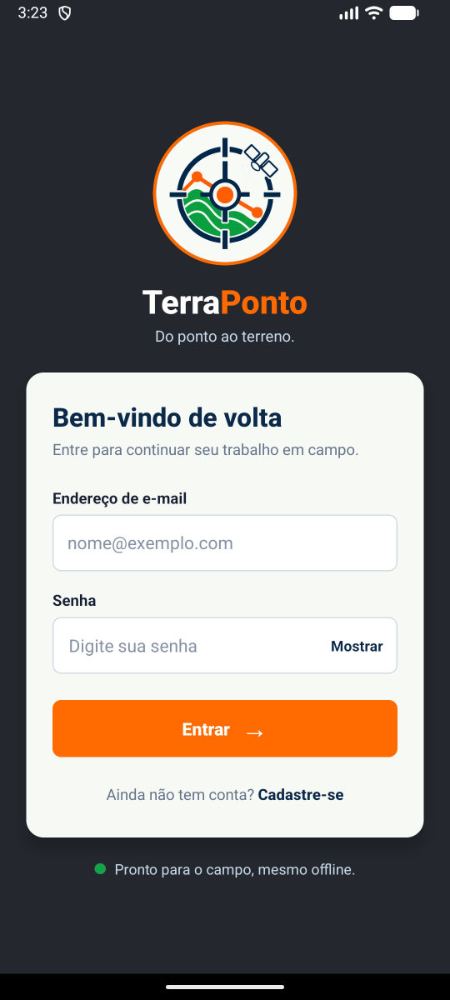<br>**Login** | 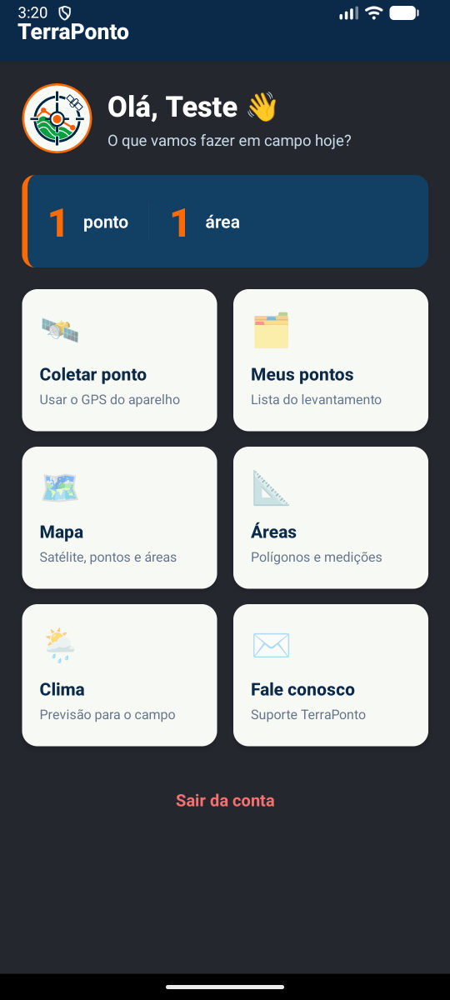<br>**Home** | 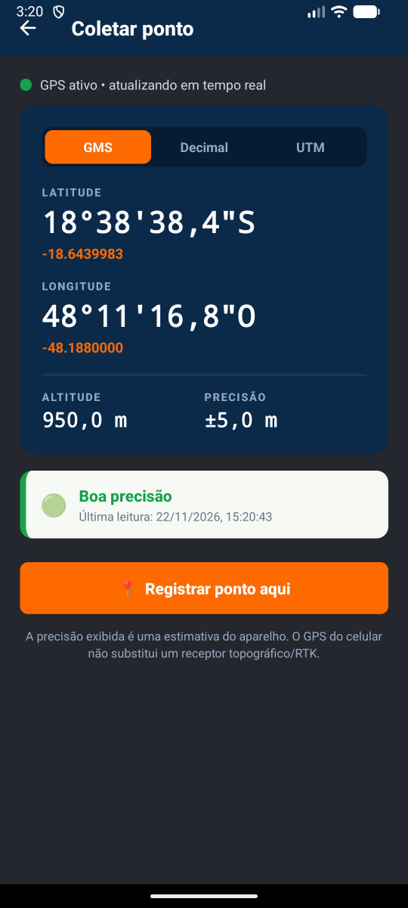<br>**Coletar ponto (GPS)** |
| 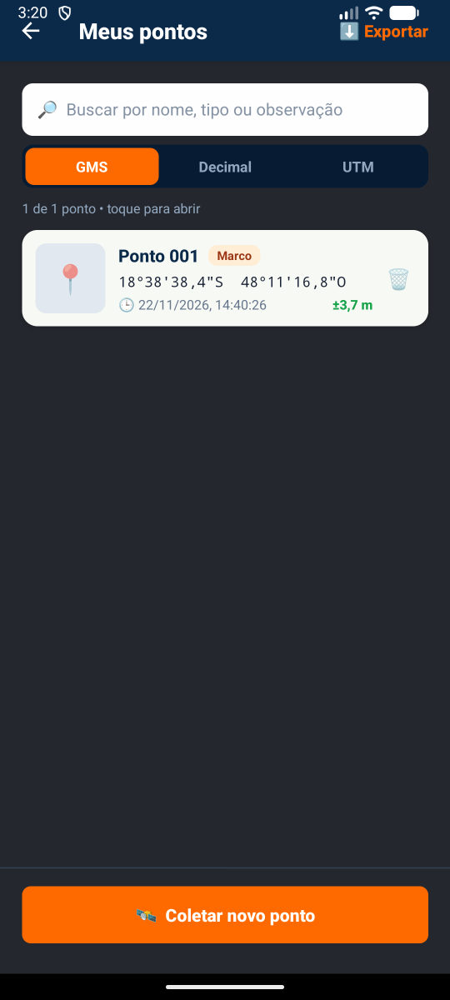<br>**Meus pontos (lista)** | 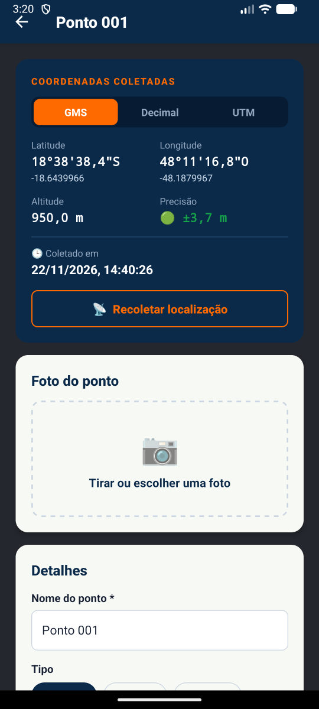<br>**Detalhe do ponto (formulário)** | 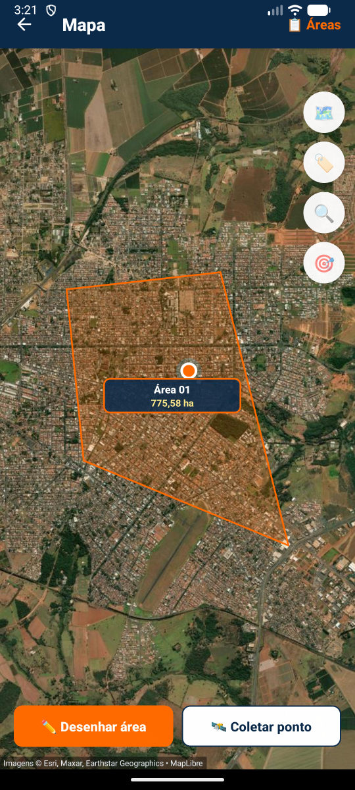<br>**Mapa de satélite** |
| 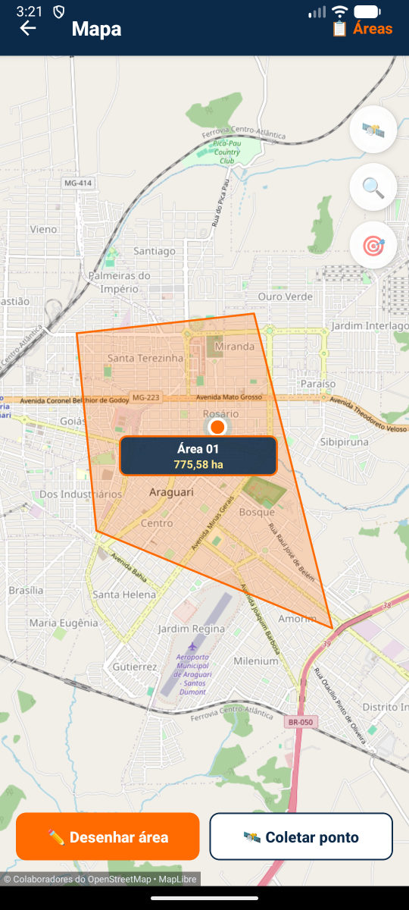<br>**Mapa de ruas** | 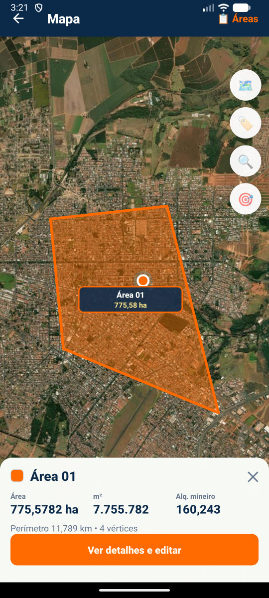<br>**Área selecionada** | 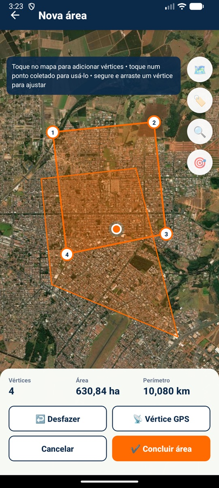<br>**Desenhando uma área** |
| 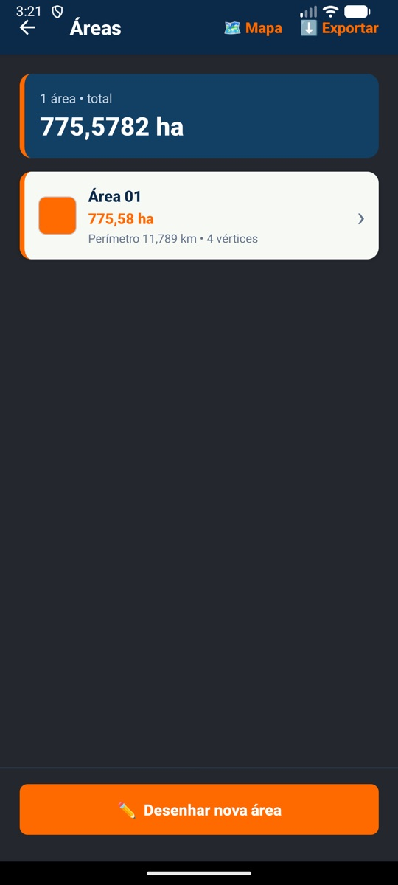<br>**Áreas (lista)** | 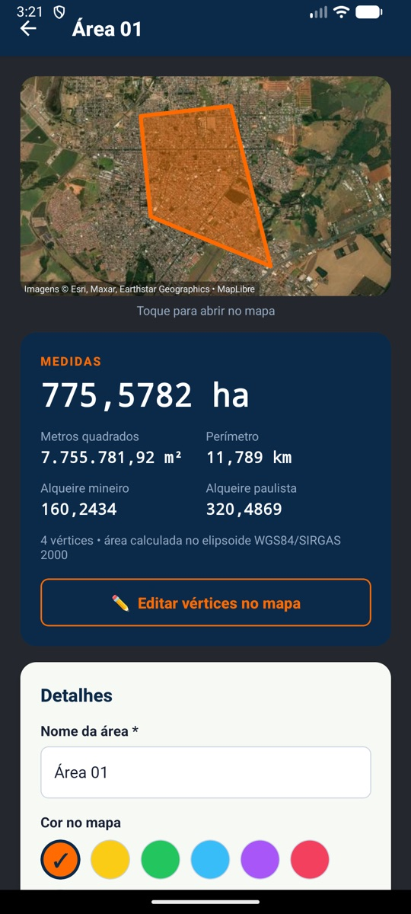<br>**Detalhe da área** | 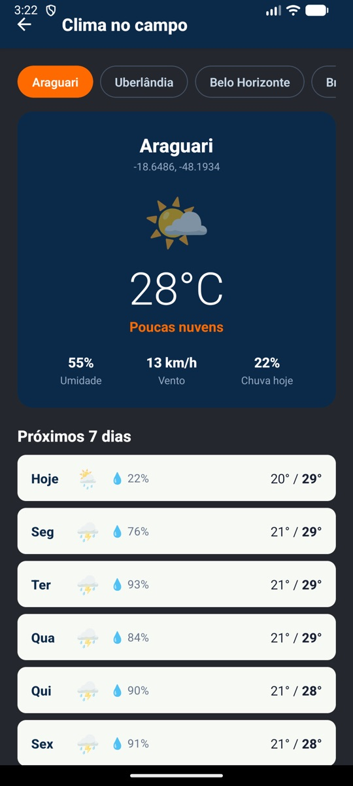<br>**Clima (API)** |
| 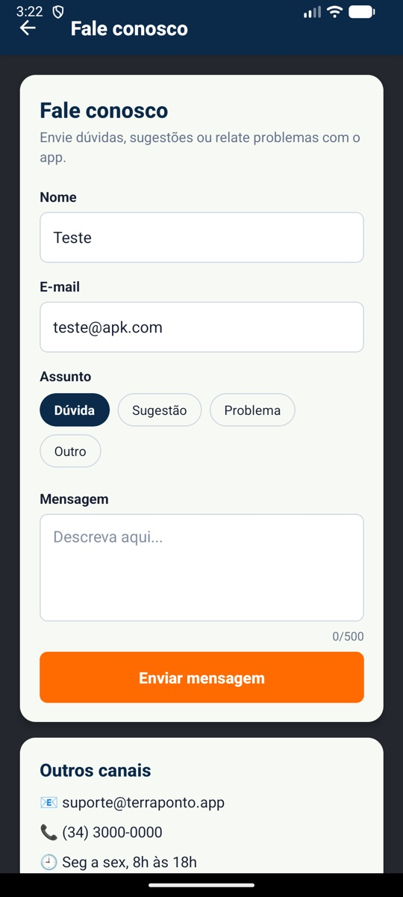<br>**Fale conosco (formulário + API)** | 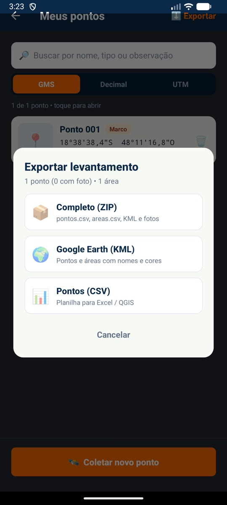<br>**Exportar** | |

## 5. Como avaliar

### Opção A — instalar o APK no celular Android
1. Copiar `TerraPonto.apk` para o celular e abrir o arquivo.
2. Permitir "instalar apps desta fonte" (e, se o Play Protect avisar, "instalar mesmo assim").
3. Criar uma conta em "Cadastre-se" e entrar.

### Opção B — rodar pelo Expo Go
```bash
npm install
npx expo start
```
Ler o QR Code com o app **Expo Go** (Android) ou pressionar `a` com um emulador aberto.
No Expo Go o mapa usa o `react-native-maps`; no APK, o MapLibre (ver doc. técnica §12).

### Roteiro sugerido (≈ 5 minutos)
1. **Cadastro → Login** (validações aparecem ao deixar campos inválidos).
2. **Coletar ponto** → "Registrar ponto aqui" → preencher nome/tipo → **foto** → Salvar.
3. **Meus pontos**: buscar, trocar **GMS/Decimal/UTM**, abrir o ponto, **Recoletar**.
4. **Mapa**: botão 🗺️/🛰️ (satélite/ruas) → **Desenhar área** → 4 toques → arrastar um vértice →
   **Concluir** → dar nome e cor → voltar e tocar na área.
5. **Áreas** → Exportar → **Completo (ZIP)** → Compartilhar/Salvar.
6. **Clima** (trocar cidade) e **Fale conosco** (enviar e ver o protocolo da API).

## 6. Tecnologias

React Native 0.79 · Expo SDK 53 · TypeScript (strict) · React Navigation 7 · AsyncStorage ·
expo-location · expo-image-picker · expo-file-system · expo-sharing · JSZip · MapLibre ·
react-native-maps · NetInfo · APIs Open-Meteo e JSONPlaceholder · tiles Esri e OpenStreetMap.

Detalhes de arquitetura, modelo de dados, fórmulas geodésicas, decisões técnicas e limitações:
**[`DOCUMENTACAO_TECNICA.md`](DOCUMENTACAO_TECNICA.md)**.

## 7. Estrutura do código (resumo)

```
src/
├── pages/        View — uma pasta por tela (11 telas)
├── components/   View — Botao, CampoTexto, Coordenadas, Exportacao, mapa/
├── context/      ViewModel global — AuthContext, PreferenciasContext
├── services/     Model — storage, poligonos, geodesia, api, csv, kml, exportacao, permissoes
├── routes/       Navegação (rotas públicas x privadas)
└── global/       cores, estilos, formatação
```

Todos os arquivos têm um comentário de cabeçalho explicando a responsabilidade, a camada (MVVM)
e os hooks usados, além de comentários nas partes não óbvias.
